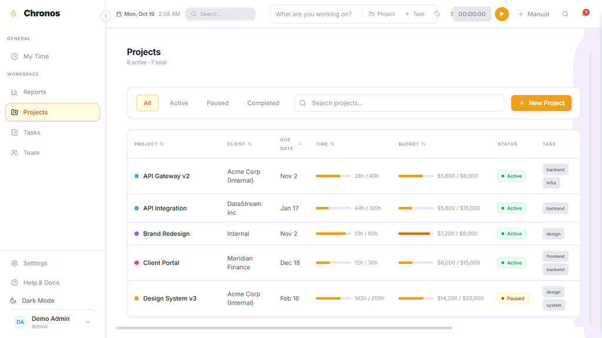
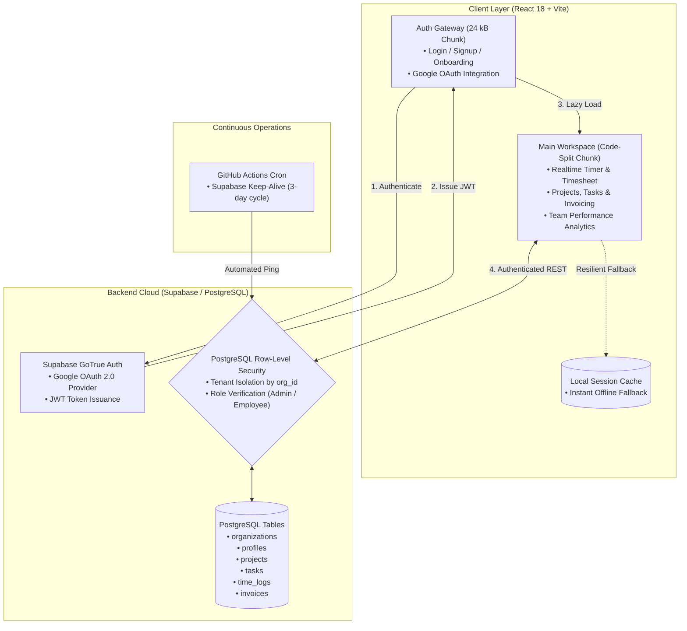

# Chronos — Enterprise Time Intelligence & Workforce Analytics

[](https://react.dev/)
[](https://vitejs.dev/)
[](https://tailwindcss.com/)
[](https://supabase.com/)
[](LICENSE)
[](https://chronos-app-rosy.vercel.app)

> **Portfolio Engineering Case Study:** Chronos is a production-grade, multi-tenant B2B time tracking and workforce management platform designed with a warm glassmorphic design system, strict PostgreSQL Row-Level Security (RLS), and a resilient dual-mode architecture.

<p align="center">
  
</p>

---

## ⚡ Live Deployments & Interactive Demos

| Environment | Purpose | Access | URL |
| :--- | :--- | :--- | :--- |
| **Instant Guest Sandbox** | Reviewer / Recruiter instant preview | **1-Click** (No signup or database required) | [chronos-demo-beige.vercel.app](https://chronos-demo-beige.vercel.app/#/my-time) |
| **Production Cloud Gateway** | Live multi-tenant deployment | Google OAuth or Email Login | [chronos-app-rosy.vercel.app](https://chronos-app-rosy.vercel.app) |

---

## 🏛️ System Architecture

Chronos is architected with a decoupled frontend, edge authentication gateway, and multi-tenant PostgreSQL persistence layer protected by strict database policies.



---

## 🛠️ Core Engineering Highlights

### 1. Dual-Bundle Code Splitting (Sub-Second Initial Load)
To minimize initial bundle weight and time-to-interactive (TTI), Chronos is split into discrete asynchronous chunks:
- **Auth Gateway Chunk (~24 kB gzipped):** Mounts instantly on `/login`, handling Google OAuth and credential validation without bundling heavy charting or data libraries.
- **Main Application Chunk (~320 kB gzipped):** Dynamically loaded only after authenticated session verification, containing Lucide iconography, interactive timesheets, project Gantt metrics, and PDF invoicing.

### 2. Multi-Tenant Row-Level Security (RLS)
Data security is enforced strictly at the database layer rather than relying on application code:
- Every query is scoped to `public.my_org_id()` derived securely from `auth.uid()`.
- **Organizations:** Members can only view their own organization; only administrators can alter workspace settings.
- **Profiles:** Users have direct read/update access to their profile (`id = auth.uid()`), with tenant-wide visibility for team members.
- **Time Logs & Tasks:** Time logs are appendable and editable exclusively by the record creator, while team aggregations remain visible across the workspace.

### 3. Dual-Mode Resilience Architecture
Chronos incorporates a self-healing client storage layer:
- In production cloud mode, all operations commit directly to Supabase via PostgREST.
- If network connectivity is interrupted or if deployed in a standalone sandbox environment without database keys, the app gracefully degrades to an in-memory / `localStorage` mock engine, ensuring hiring managers and reviewers can evaluate every workflow without backend dependencies.

### 4. Automated Cloud Keep-Alive
Supabase free-tier instances auto-pause after 7 days of API inactivity. This repository includes an automated GitHub Actions cron workflow (`.github/workflows/supabase-keepalive.yml`) that queries the REST endpoint every 72 hours, ensuring the database remains warm and responsive for portfolio visitors.

---

## 📊 Database Schema Overview

```
organizations (id, name, industry, timezone, created_at)
  └── profiles (id [auth.users FK], org_id [FK], full_name, role, hourly_rate, avatar_url)
        ├── projects (id, org_id [FK], name, client, budget, goal_hours, status)
        │     └── tasks (id, org_id [FK], project_id [FK], title, status, priority, time_logged)
        ├── time_logs (id, org_id [FK], user_id [FK], project_id [FK], task_id [FK], started_at, ended_at, duration_hours)
        └── invoices (id, org_id [FK], invoice_number, client_name, subtotal, tax, total, status, line_items)
```

The comprehensive migration script including extensions, triggers, RLS policies, and indexing is maintained at [`supabase/schema.sql`](supabase/schema.sql).

---

## 💻 Local Development Setup

### 1. Clone the repository
```bash
git clone https://github.com/NiL4gh/chronos-app.git
cd chronos-app
```

### 2. Install dependencies
```bash
npm install
```

### 3. Configure Environment Variables
```bash
cp .env.example .env
```
Populate `.env` with your Supabase credentials:
```env
VITE_SUPABASE_URL=https://your-project-ref.supabase.co
VITE_SUPABASE_ANON_KEY=your-anon-public-key
```
*(Optional: If left blank, Chronos automatically boots in Demo Sandbox mode with sample data).*

### 4. Start Development Server
```bash
npm run dev
```

### 5. Production Build & Linting
```bash
npm run build    # Compiles production bundles in dist/
npm run lint     # Runs ESLint checks
```

---

## 📦 Tech Stack

- **Frontend Core:** [React 18](https://react.dev/), [Vite 5](https://vitejs.dev/), [React Router v6](https://reactrouter.com/)
- **Styling & UI:** [Tailwind CSS 3](https://tailwindcss.com/), Custom Glassmorphism CSS design tokens, [Lucide React](https://lucide.dev/)
- **Backend & Auth:** [Supabase](https://supabase.com/) (PostgreSQL 15, PostgREST, GoTrue Auth with Google OAuth)
- **CI/CD & Hosting:** [Vercel](https://vercel.com/), [GitHub Actions](https://github.com/features/actions)
- **Desktop (Optional):** [Electron](https://www.electronjs.org/) wrapper support

---

## 📄 License

This project is licensed under the [MIT License](LICENSE).
